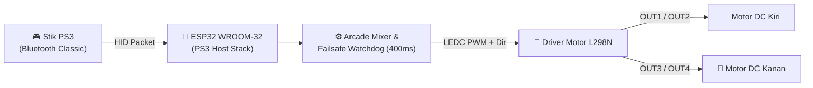

# ⚽ Robot Soccer ESP32 — PS3 Controller & L298N

-blue?style=flat-square&logo=espressif)
-003791?style=flat-square&logo=playstation)


Firmware **Robot Soccer** berbasis **ESP32 (Bluetooth Classic)** dengan kendali nirkabel menggunakan **Stik PS3 (DualShock 3)** dan driver motor **L298N**. Dirancang untuk manuver responsif di arena lomba dengan kendali *differential drive* (arcade mixing), dua mode kecepatan instan (**L1/R1**), kalibrasi trim motor di software, serta *failsafe watchdog* otomatis saat koneksi terputus.

Repository ini juga menyertakan **patch kompatibilitas untuk Arduino ESP32 Core v3.x (`3.3.10`)** agar library `PS3 Controller Host` dapat berjalan tanpa galat kompilasi maupun kegagalan alokasi memori Bluetooth Classic.

---

## ✨ Fitur Utama

- **Kendali Differential Drive Halus (Arcade Mixing):** Menggabungkan sumbu maju/mundur (`LY`) dan belok (`LX`) pada analog kiri secara proporsional.
- **Manuver Cepat via Action Buttons:** Tombol `Segitiga`, `X`, `Kotak`, dan `Bulat` mengambil alih prioritas kendali untuk maju, mundur, dan *pivot turn* (putar di tempat) secara instan.
- **2 Mode Kecepatan (L1 / R1):**
  - **Mode Lambat / Presisi (`L1` — PWM 155):** Untuk menggiring bola dan manuver sempit.
  - **Mode Cepat / Sprint (`R1` — PWM 255):** Untuk mengejar bola atau menendang/mendorong.
- **Failsafe Watchdog (400 ms):** Motor otomatis berhenti seketika jika stik PS3 terputus atau paket data Bluetooth berhenti masuk lebih dari `400 ms`.
- **Kalibrasi Motor di Software:** Pengaturan persentase daya (`DAYA_MOTOR_KIRI_PERSEN` / `DAYA_MOTOR_KANAN_PERSEN`) dan pembalik arah (`BALIK_ARAH_MOTOR_*`) langsung di [`robot_soccer_ps3/config.h`](robot_soccer_ps3/config.h) tanpa perlu bongkar kabel.
- **Siap untuk ESP32 Arduino Core 3.x:** Dilengkapi patch `esp_mac.h` dan `esp32-hal-alloc-bt-classic-mem.h` serta skrip instalasi otomatis.

---

## 🧭 Arsitektur Sistem



> [!IMPORTANT]
> Gunakan papan **ESP32 generasi klasik** yang mendukung **Bluetooth Classic (BR/EDR)** seperti **ESP32-WROOM-32 / ESP32 Dev Module**. Varian seperti ESP32-S3 atau ESP32-C3 hanya memiliki BLE sehingga tidak kompatibel dengan protokol stik PS3.

---

## 📂 Struktur Repository

```text
├── robot_soccer_ps3/
│   ├── robot_soccer_ps3.ino      # Firmware utama Robot Soccer
│   └── config.h                  # Konfigurasi pin, MAC address, batas PWM, & kalibrasi motor
├── ps3_connection_test/
│   └── ps3_connection_test.ino   # Sketch diagnostik Bluetooth Classic & pengecekan MAC asli ESP32
├── patches/
│   └── PS3_Controller_Host_esp32_core3/
│       ├── ps3.c                 # Fix #include <esp_mac.h> untuk ESP32 Core 3.x
│       ├── Ps3Controller.cpp     # Fix alokasi memori BT Classic pada ESP32 Core 3.3.x
│       └── apply_patch.ps1       # Skrip PowerShell untuk memasang patch otomatis
└── README.md
```

---

## 🔌 Skema Pengkabelan (Pinout)

Lepaskan jumper pada pin **ENA** dan **ENB** di modul **L298N** agar kecepatan motor dapat diatur menggunakan sinyal PWM dari ESP32.

| Pin L298N | Pin ESP32 | Fungsi |
| :--- | :--- | :--- |
| **ENA** *(lepas jumper)* | `GPIO 25` | PWM Kecepatan Motor Kiri |
| **IN1** | `GPIO 18` | Arah Motor Kiri A |
| **IN2** | `GPIO 19` | Arah Motor Kiri B |
| **IN3** | `GPIO 21` | Arah Motor Kanan A |
| **IN4** | `GPIO 22` | Arah Motor Kanan B |
| **ENB** *(lepas jumper)* | `GPIO 26` | PWM Kecepatan Motor Kanan |
| **GND** | `GND` | Ground Bersama (**Wajib disatukan dengan GND ESP32**) |

- **OUT1 & OUT2** $\rightarrow$ Motor DC Kiri
- **OUT3 & OUT4** $\rightarrow$ Motor DC Kanan
- **12V / VMS L298N** $\rightarrow$ Baterai Motor (sesuai tegangan kerja motor)

---

## 🎮 Pemetaan Tombol Stik PS3

| Input Stik PS3 | Aksi Robot | Keterangan |
| :--- | :--- | :--- |
| **Analog Kiri (Atas / Bawah)** | Maju / Mundur | Kecepatan proporsional sesuai kemiringan analog |
| **Analog Kiri (Kiri / Kanan)** | Belok Kiri / Kanan | *Differential steering*, bisa digabung saat maju/mundur |
| **Segitiga ($\triangle$)** | Maju Penuh | Mengikuti batas PWM mode aktif (prioritas di atas analog) |
| **Silang ($\times$)** | Mundur Penuh | Mengikuti batas PWM mode aktif |
| **Kotak ($\square$)** | Putar Kiri (*Pivot*) | Roda kiri mundur, roda kanan maju |
| **Bulat ($\bigcirc$)** | Putar Kanan (*Pivot*) | Roda kiri maju, roda kanan mundur |
| **L1** | Mode Lambat (`PWM 155`) | Mode default saat menyala; tetap aktif setelah tombol dilepas |
| **R1** | Mode Cepat (`PWM 255`) | Mode kecepatan maksimal; tetap aktif setelah tombol dilepas |

---

## 🚀 Cara Instalasi & Upload

### 1. Persiapan Library & Patch ESP32 Core 3.x
1. Buka **Arduino IDE**, pastikan board **esp32 by Espressif Systems** (diuji pada versi `3.3.10`) dan library **PS3 Controller Host** (`1.1.0`) sudah terpasang.
2. Jika menggunakan **ESP32 Core 3.x**, jalankan skrip patch berikut di PowerShell agar library `PS3 Controller Host` mendukung header MAC dan alokasi memori Bluetooth Classic terbaru:
   ```powershell
   .\patches\PS3_Controller_Host_esp32_core3\apply_patch.ps1
   ```
   *(Atau salin manual file `ps3.c` dan `Ps3Controller.cpp` dari folder `patches/PS3_Controller_Host_esp32_core3/` ke `Documents\Arduino\libraries\PS3_Controller_Host\src\`).*

### 2. Pairing MAC Address Stik PS3
1. Hubungkan stik PS3 ke PC menggunakan kabel USB dan buka aplikasi **Sixaxis Pair Tool**.
2. Lihat alamat **Current Master** (atau tulis alamat MAC baru, misalnya `00:23:06:7B:8A:1E`).
3. Pastikan nilai `MAC_HOST_PS3` di dalam [`robot_soccer_ps3/config.h`](robot_soccer_ps3/config.h) sama persis dengan alamat **Current Master** pada stik:
   ```cpp
   constexpr char MAC_HOST_PS3[] = "00:23:06:7B:8A:1E";
   ```

### 3. Upload & Pengujian
1. Pilih board **ESP32 Dev Module** di Arduino IDE, lalu upload sketch [`robot_soccer_ps3/robot_soccer_ps3.ino`](robot_soccer_ps3/robot_soccer_ps3.ino).
2. Buka **Serial Monitor** pada baud rate **115200**. Pastikan muncul:
   ```text
   [INFO] MAC host ESP32: 00:23:06:7B:8A:1E
   [INFO] Pastikan Current Master stik = 00:23:06:7B:8A:1E, lalu tekan tombol PS.
   ```
3. Cabut kabel USB dari stik PS3, lalu tekan tombol **PS**. Saat terhubung, Serial Monitor akan menampilkan `[INFO] Stik PS3 tersambung.`

---

## 🛠️ Kalibrasi & Troubleshooting

- **Robot belok sendiri saat jalan lurus:**
  Sesuaikan `DAYA_MOTOR_KIRI_PERSEN` atau `DAYA_MOTOR_KANAN_PERSEN` (misalnya `92`–`98`) pada [`robot_soccer_ps3/config.h`](robot_soccer_ps3/config.h) untuk menyeimbangkan kecepatan motor kiri dan kanan.
- **Arah putaran salah satu roda terbalik:**
  Ubah `BALIK_ARAH_MOTOR_KIRI` atau `BALIK_ARAH_MOTOR_KANAN` menjadi `true` di [`robot_soccer_ps3/config.h`](robot_soccer_ps3/config.h), atau tukar kabel `OUT1`/`OUT2` (`OUT3`/`OUT4`) pada terminal L298N.
- **Muncul pesan `Gagal mengaktifkan Bluetooth PS3.`:**
  Upload sketch diagnostik [`ps3_connection_test/ps3_connection_test.ino`](ps3_connection_test/ps3_connection_test.ino) terlebih dahulu untuk menguji inisialisasi Bluetooth tanpa mengganti MAC ESP32. Catat `MAC asli ESP32` yang tampil di Serial Monitor dan masukkan alamat tersebut ke **Sixaxis Pair Tool**.

---

## 📄 Lisensi

Proyek ini dilisensikan di bawah [MIT License](LICENSE) — © 2026 [ArifAmar](https://github.com/ArifAmar).
